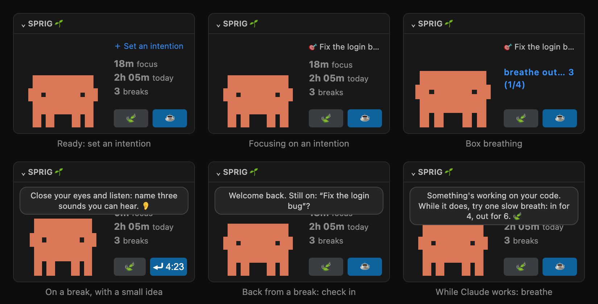
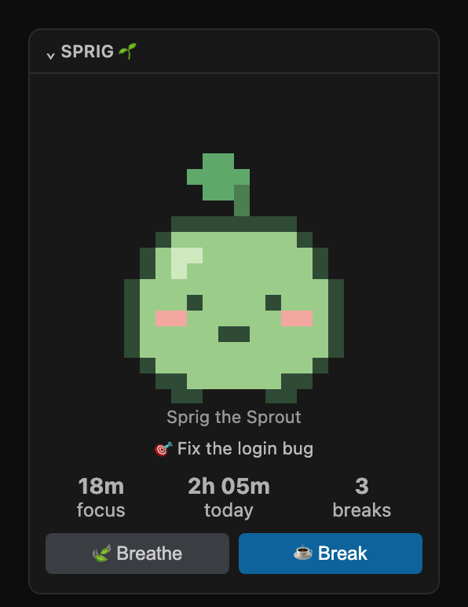
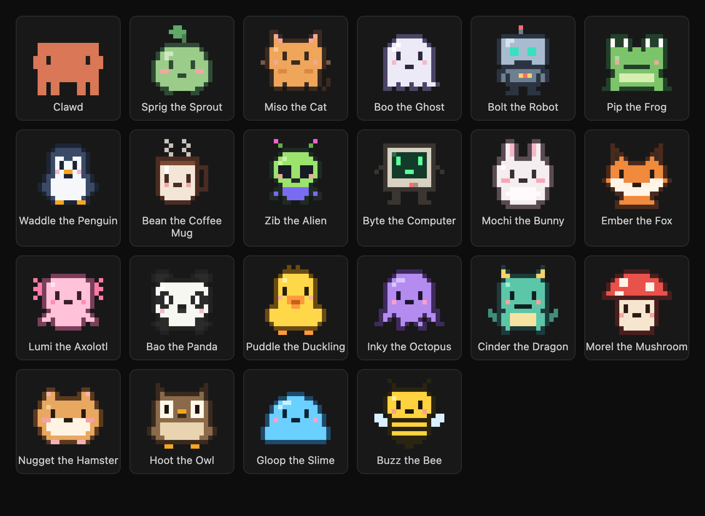

# Sprig 🌱

**A mindful coding companion for VS Code.** Set an intention, focus, take real breaks, breathe, and reflect, with a tiny pixel pet keeping you company in the sidebar.



## A mindful session

Sprig is built around one loop: **intention → focus → break → reflect.**

1. **Set an intention.** Click **＋ Set an intention** in the panel. Pick one small, clear thing, like "Fix the login bug". Sprig starts you off with one settling breath, and your intention stays in view while you work.
2. **Focus.** Sprig counts only *active* time: minutes when you (or Claude) are actually changing files.
3. **Take real breaks.** After 25 minutes Sprig suggests a break, each with a small idea: stretch, walk slowly, name three sounds you can hear, drink water away from the screen. When you come back, it checks in: *still on the same intention?*
4. **Breathe while Claude works.** When files change in a burst you didn't type, Sprig suggests one slow breath instead of watching the screen.
5. **Reflect.** End the session and answer three short questions: did you do it, how do you feel, and one note for future you. Everything goes to your **Mindful Journal**.

```markdown
## Tuesday, 24 November 2026

### ✅ Fix the login bug
10:02–11:31 · 1h 12m focused · 2 breaks · felt 😌 Calm and clear

> Writing a failing test first helped
```

## Features

- **Box breathing**: 4 rounds of 4 in, 4 hold, 4 out, 4 hold. The pet breathes with you.
- **Gentle nudges**: 20-20-20 eye rest, water reminders, and a late-night "go to sleep" note.
- **Pause reminders** for 30 minutes, 1 hour, 2 hours or until tomorrow.
- **This week's focus**: a 7-day history of your focus time.
- **Celebrates fixed errors**: the pet cheers when the last error in your files is gone.
- **Fits any panel**: the pet scales with the panel. Short panels switch to a compact side-by-side layout; taller ones get the full layout.
- **Status bar**: `🌱 18m` shows your current focus time. Click it for the Sprig menu.
- **Private by design**: everything stays on your machine. Sprig makes no network requests.



## 22 pets

Sprig the Sprout is the default, with Clawd next in the list. Change pets with **Sprig: Choose Pet** (↑/↓ previews each one live in the panel) or double-click the pet.



## Install

Sprig isn't on the Marketplace. Build and install it from this repo:

```sh
./build.sh                                          # writes dist/sprig-mindful-pet-<version>.vsix
code --install-extension dist/sprig-mindful-pet-*.vsix --force
```

Then run **Developer: Reload Window**. Sprig appears in the Explorer sidebar.

## Commands

Open the Command Palette (Cmd/Ctrl+Shift+P) and type "Sprig":

| Command | What it does |
|---|---|
| Sprig: Open Menu | Everything below in one place (same as clicking the status bar) |
| Sprig: Start Mindful Session | Set an intention and begin |
| Sprig: Change Intention | Switch what you're focusing on |
| Sprig: End Session & Reflect | Close the session with a short reflection |
| Sprig: Open Mindful Journal | Read past sessions and notes |
| Sprig: Breathe With Me (1 min) | Guided box breathing |
| Sprig: Start a Break Now | Start a break with a countdown |
| Sprig: Pause Reminders… | Mute nudges for a while |
| Sprig: Show This Week's Focus | 7-day focus history |
| Sprig: Choose Pet | Pick a pet with live preview |
| Sprig: Reset Focus Timer | Start the focus count from zero |
| Sprig: Show Pet | Reveal the panel |

## Settings

| Setting | Default | |
|---|---|---|
| `sprig.pet` | `sprout` | Which pet keeps you company |
| `sprig.focusMinutes` | `25` | Minutes of active coding before a break is suggested |
| `sprig.breakMinutes` | `5` | Length of a break |
| `sprig.eyeReminderMinutes` | `20` | 20-20-20 eye rest interval (0 turns it off) |
| `sprig.hydrationMinutes` | `45` | Water reminder interval (0 turns it off) |
| `sprig.breakNotifications` | `true` | Also show break suggestions and "break's over" as VS Code notifications |

## Good to know

- Claude's edits only count as activity when a **folder is open** in VS Code. Changes in `.git`, `node_modules`, `dist`, `out` and `build` are ignored.
- If you use several VS Code windows at once, each keeps its own counts.
- Clawd is Anthropic's Claude Code mascot, redrawn here as unofficial fan art. It isn't covered by the MIT license; see [NOTICE](NOTICE).

## Development

```sh
node test/smoke.js               # logic checks against a fake VS Code API
python3 docs/make-screenshots.py  # regenerate the screenshots (needs Google Chrome)
./build.sh                       # package the extension
```

The extension is plain JavaScript with no dependencies: `extension.js` (timers, sessions, commands) and `media/pet.html` (the panel and pets).

## License

[MIT](LICENSE), except the Clawd sprite, which is Anthropic's mascot and isn't covered by it. See [NOTICE](NOTICE).
